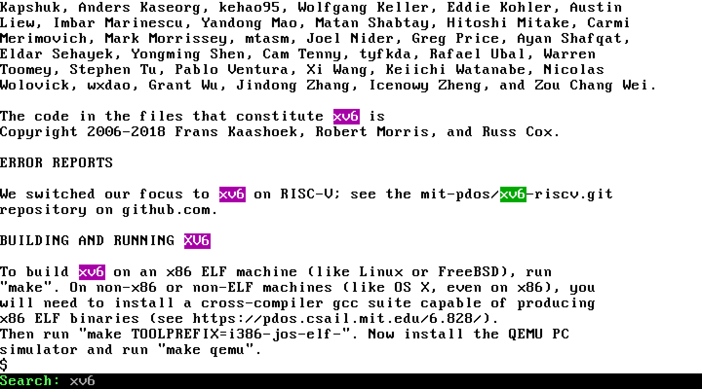

# xv6 Console Search

Live, highlighted text search for the **xv6** console (x86, C). Press Alt+F and start typing: every match on the screen lights up, and Alt+N / Alt+P jump between them.

Operating Systems course assignment, School of Computing (RAF), Belgrade, 2026.



## What it does

- **Alt+F** turns search mode on and off. The bottom row becomes a `Search:` bar, and the rest of the screen switches to black text on a white background so highlights stand out.
- The screen is searched as you type, ignoring case. All matches turn purple, the current match turns green, and the hardware cursor moves to it.
- **Alt+N** and **Alt+P** go to the next and previous match and wrap around at the ends. **Backspace** edits the query.
- While search mode is on, keystrokes never reach the shell.
- Pressing **Alt+F** again puts back the exact screen contents, colors and cursor position from before the search. The last query is remembered and searched again the next time.

## How it works

- **Keyboard driver.** The PS/2 keyboard driver (`kbd.c`, `kbd.h`) already tracks the Alt key. I added an Alt key map, so Alt+F, Alt+N and Alt+P reach the console as their own key codes.
- **Screen.** The console writes straight into the memory-mapped VGA text buffer at physical address `0xB8000`: 80 × 25 cells, each a character byte and a color byte. Entering search mode copies all 2,000 cells and reads the cursor position from the CRT controller through I/O ports `0x3D4`/`0x3D5`. Leaving search mode writes both back.
- **Search.** Knuth–Morris–Pratt over the 1,920 cells of rows 0–23. For each search, the prefix (LPS) table is built from the query, then the screen is scanned in O(n + m) time without stepping back. A small `toLower` makes the search case-insensitive.
- **Highlighting** changes only the color byte of each cell, so the text is never touched.
- When a shorter query finds fewer matches, the current-match index is reset, so it never points past the results.

## Where the code is

| File | Change |
|---|---|
| [`kernel/console.c`](kernel/console.c) | Search mode in `consoleintr`, KMP search (`napravi_prefiksnu_tabelu`, `KMP_pretrazi`), highlighting (`istakniRezultate`), the search bar (`crtaj_searchBar`) and the color switch (`okreniBoje`) |
| [`kernel/kbd.h`](kernel/kbd.h), [`kernel/kbd.c`](kernel/kbd.c) | Alt key map and key codes |

Everything else is unchanged xv6, except two build tweaks in the `Makefile`: the Perl helper scripts are run through `perl`, so the project builds even if file permissions were lost, and the xv6 readme was renamed to `README.xv6`.

Identifiers and comments are in Serbian, the course language: *pretraga* = search, *ključna reč* (`kljucnaRec`) = keyword, *prefiksna tabela* = prefix table, *istakni rezultate* = highlight results, *okreni boje* = flip colors.

## Build and run

You need Linux (or WSL), `make`, `perl`, QEMU, and a GCC that can build 32-bit code (or an `i686-elf` cross-compiler). On Ubuntu or Debian:

```sh
sudo apt install build-essential gcc-multilib qemu-system-x86
make qemu
```

Use `make qemu`, which opens a QEMU window. With `make qemu-nox`, keystrokes arrive through the serial port and never reach the keyboard driver, so the Alt shortcuts do not work there.

In the xv6 window, run `cat /home/README.xv6` so there is text on the screen, then press Alt+F and type `xv6`.

Checked in QEMU: highlighting as you type, Alt+N and Alt+P wrapping around, Backspace, restoring the screen and cursor, keystrokes not reaching the shell, and the remembered query. xv6's own `usertests` still pass.

## Credits

Based on [xv6](https://github.com/mit-pdos/xv6-public) by Frans Kaashoek, Robert Morris and Russ Cox (MIT License, see [`LICENSE`](LICENSE) and [`README.xv6`](README.xv6)), in the version used for the Operating Systems course at RAF.
